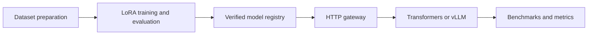
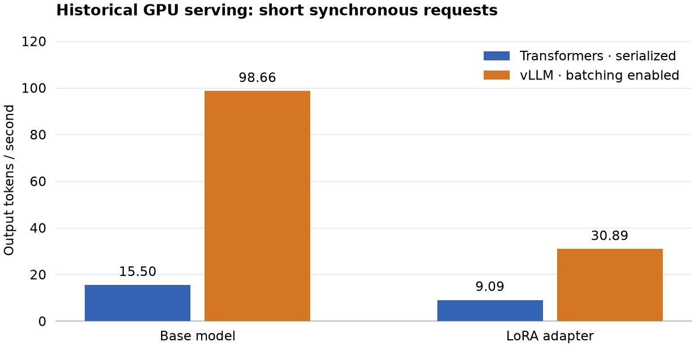

# LLM Fine-Tuning and Inference Serving Platform

Adapt an open-weight LLM with LoRA, compare it with prompting on frozen data, and
serve verified adapters through Transformers or vLLM. This Python platform connects
reproducible post-training, versioned HTTP deployment and measured GPU performance;
enterprise incident triage is its demonstration workload.

[Results](docs/results.md) · [Architecture](docs/architecture.md) ·
[Reproduce](docs/reproducibility.md) · [Model card](docs/model-card.md) ·
[Benchmarks](docs/benchmark.md) · [Security](docs/security.md) ·
[Polish handoff](docs/polish-handoff.md)



## Verified reference evidence

These are recorded experiments on an **RTX 4060 Laptop GPU, 8 GB**, using
**Qwen2.5-0.5B-Instruct**. Each report retains its source and dependency identities.

| What was demonstrated | Evidence |
|---|---|
| Real GPU adaptation | 80 LoRA optimizer steps in 171.165 s; 540,672 trainable parameters; exported/reloaded adapter; 1.49 GiB peak tensor allocation. [Training records](evidence/training/) |
| Controlled quality comparison | Category accuracy: zero-shot 2/40, stronger prompt 7/40, LoRA **15/40**. Only **eight independent test families**; required abstention **0/5** for every alternative. [Model card](docs/model-card.md) |
| Genuine inference and reliability | Sync/SSE generation, immutable identity, auth, cancellation, promotion/rollback and overload recovery. [HTTP evidence](evidence/serving/lifecycle/) · [post-fix GPU smoke](evidence/post-release/gpu-smoke/report.json) |
| Measured serving experiments | 28 runs with raw requests, TTFT, throughput, GPU samples and errors; precision corrections and unsuccessful experiments preserved. [Method](docs/benchmark.md) |
| Annotation provenance | Six fresh, owner-attested independent judgments over two new cases; the six historical AI-assisted labels remain separate. This small subset is no population estimate. [Correction and fresh review](docs/review-provenance.md) |

The adapted model still misclassified 25/40 incidents. Its results do not justify
autonomous triage; recommendations never execute operational actions.

## Measured serving configurations



**Units: output tokens/second.** Historical BF16, non-quantized model configurations;
short synchronous prompts, client concurrency 4, output cap 32, 12 measured requests
per run, two repetitions and two excluded warmups per run. Bars are medians of
run-level throughput. Transformers serializes generation in one gateway slot;
vLLM allows eight slots and up to eight batched sequences. These are system
configuration comparisons, not a new scheduler or kernel implementation.

[Raw reports and figure inputs](docs/assets/serving-throughput.json) ·
[Full comparison](evidence/serving/comparison.md) · [Download SVG](docs/assets/serving-throughput.svg)

Small samples limit generalization. Prefix caching reduced throughput in its
measured workload, and queue timeouts remain in the long-adapter results. Historical
numbers are not transferred to a newer dependency stack without new measurements.

## Try the platform

For lightweight CPU validation, use Python 3.12 from Bash/WSL at the repository root:

```bash
python -m venv .venv
source .venv/bin/activate  # Windows: .venv\Scripts\Activate.ps1
python -m pip install --require-hashes -r requirements/cpu.lock
python -m pip install --no-deps -e .
CUDA_VISIBLE_DEVICES="" pytest -q
llm-platform data verify data/triage-v3
llm-platform audit-evidence
```

In PowerShell, use `python -c "import os; os.environ['CUDA_VISIBLE_DEVICES']=''; import pytest; raise SystemExit(pytest.main(['-q']))"`
to hide CUDA before any test imports (an empty PowerShell environment assignment
can remove the variable).
The audit checks provenance and integrity; it cannot attest identity or certify
security. CPU tests establish no GPU performance claim.
See the [actual CI workflow](https://github.com/ThePhysic/llm-finetuning-serving-platform/actions/workflows/ci.yml).

For genuine model execution, follow the [Linux/WSL2 setup](docs/reproducibility.md)
and [dependency guidance](docs/dependency-migration.md). In a configured GPU terminal:

```bash
llm-platform registry register evidence/adapter-package --registry runtime/registry
llm-platform serve --registry runtime/registry \
  --model 1183832f233f3a2f720a98efad446cffb2ada613cc59860fedd58e186af6838c
```

In another terminal, send a real request with the demonstration client:

```bash
python scripts/demo.py --url http://127.0.0.1:8000 --stream \
  --report "Warehouse reports no stock; inventory shows 12 units; the latest synchronization timed out."
```

The client prints the actual served artifact and generated text. It rejects
truncated streams and mismatched identities. No fabricated response or screenshot
is used here. The supported API includes `/v1/chat/completions`, `/v1/models`,
`/health/live`, `/health/ready`, `/metrics` and protected deployment administration.

## Reproduce and inspect

| Area | Documentation |
|---|---|
| Data, leakage controls and frozen splits | [Dataset](docs/dataset.md) |
| LoRA, checkpoints and training/serving quantization distinction | [Training](docs/training.md) |
| Automatic scores and annotation provenance | [Evaluation](docs/evaluation.md) · [Review correction](docs/review-provenance.md) |
| Integrity, deployment and rollback | [Registry](docs/registry.md) · [Serving](docs/serving.md) |
| Runtime and container requirements | [Deployment](docs/deployment.md) · [Dependency migration](docs/dependency-migration.md) |
| Failures, corrections and limitations | [Post-release audit](docs/post-release-audit.md) · [Polish handoff](docs/polish-handoff.md) |

The preserved GPU stacks have known upstream advisories and are for isolated,
trusted reproduction. A separate, zero-known-match audited training/Transformers
candidate passed real GPU compatibility checks; a modern vLLM migration remains
unvalidated on the installed driver. Read the [current security findings](docs/security.md)
before non-local use. Worker authentication and disabled browser CORS do not patch
a vulnerable dependency. GPU-container build/run claims are reported separately in
the [polish verification report](docs/polish-handoff.md); a recipe alone is not evidence.

Code is MIT licensed; authored synthetic fixtures are CC0-1.0. The Qwen model and
derived adapter remain subject to the publisher's Apache-2.0 license. Base weights,
credentials, private incident data and local agent instructions are not included
in the current repository tree. Historical Git ancestry is preserved.
