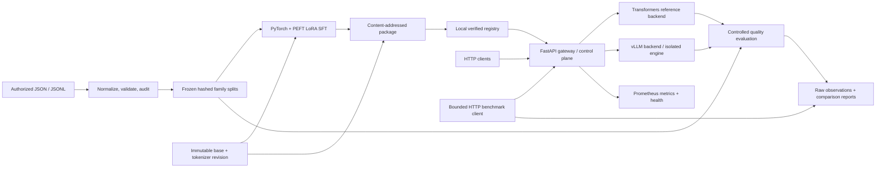

# Architecture and engineering tradeoffs

The reusable product is the adaptation, evaluation, packaging, serving, and
measurement system. Enterprise operations exception triage is its demonstration
workload. No recommendation executes an operational action.

## Three independent questions

1. **Model quality:** Does changing model weights improve held-out task behavior
   relative to an original instruction model and an authored stronger prompt?
   Dataset identity, exact prompt, decoding, and per-example generations establish
   what was compared. Engine speed is not evidence of better understanding.
2. **Runtime performance:** How do equivalent weights behave under controlled
   concurrency, prompt/generation lengths, cache states, and engine settings?
   Latency and throughput come from actual HTTP observations and hardware sampling.
   Different model quality is not a speed optimization.
3. **Reliability:** Do malformed requests, overload, failures, cancellation, model
   switching, and rollback preserve bounded resources and truthful deployment state?
   Tests verify control-plane invariants independently from semantic accuracy.

CPU tests establish data and API behavior. They cannot establish GPU training
feasibility, inference throughput, memory use, or production incident quality.

## Data and adaptation

`data.py` normalizes external instruction formats into task records, validates gold
targets, audits duplicates and near duplicates, and creates immutable manifests.
Connected scenario/family/near-duplicate groups remain together. Category-stratified
allocation preserves class coverage when at least three independent groups exist
per category signature; insufficient groups cause a visible error. The primary
`triage-v3` test includes eight independent unseen families, with five correlated
renderings each. General-instruction regression data is never a training input.

`training.py` uses a visible PyTorch optimization loop and PEFT adapters. Prompt
tokens are masked from completion loss. Tokenization verifies the full conversation
budget and the exact prompt prefix instead of silently truncating targets. Seeds,
immutable base revision, dataset split hashes, configuration, source hashes,
trainable parameters, losses, elapsed time, device memory, software versions, and
checkpoint state are preserved. Checkpoint restoration checks base, dataset, and
configuration compatibility. Saved adapters use safetensors; no untrusted remote
model code is enabled.

LoRA updates a small subset of trainable parameters. Optional QLoRA quantizes the
frozen training base to NF4; it does not make an exported adapter a quantized serving
model. Serving quantization is a separate runtime/package choice and requires its
own quality and performance evidence. The default experiment uses ordinary LoRA;
do not claim a QLoRA result merely because a configuration option exists.

## Artifact identities and registry

Packages contain tokenizer/chat-template files, adapter files where applicable,
configuration, provenance, and an immutable manifest. Base weights stay in the
model cache rather than source control. The artifact ID hashes canonical manifest
content, including the file inventory and every packaged file hash. Verification
rejects missing/unexpected files, corrupt bytes, symlinks, unsafe paths, revision
mismatches, incompatible adapter configuration, and chat-template changes before
model loading. Base and tokenizer revisions must match for the supported runtimes.

The dataset content ID identifies normalized records. Its manifest hash additionally
identifies transformation settings and split files. Training provenance records
both split hashes and the frozen manifest identity; evaluation also records its
own scorer/prompt source hashes and code revision separately from the adapter's
training code. An artifact's presence in the registry does not certify model
quality: absent evaluation is explicitly represented as a limitation.

This is a local **single-writer** registry with atomic deployment-pointer updates,
not a distributed metadata service. Hashes detect accidental or unauthorized byte
changes relative to trusted metadata; they are not publisher signatures. Filesystem
permissions and trusted launch/deployment operators remain part of the boundary.

## Gateway, scheduling, and resource ownership

FastAPI owns the supported OpenAI-compatible HTTP subset, validation, authorization,
token/body limits, bounded queue admission, execution slots, deadlines, stable
errors, health, metrics, and administration. Backends implement the small
`contracts.py` interface: load/unload, exact token count, async text/token stream,
cancel, and health. A request pins its deployment lease, so a concurrent switch
cannot silently change its model identity. Requests select the active immutable
artifact; unserved registry entries are discoverable but are not implicitly loaded.

The Transformers backend serializes generation on its model because its token
streamer, model state, and seeded RNG are shared. It runs actual model generation
in a worker thread. Cancellation sets a stopping event, closes the iterator, and
waits for the worker before releasing the lock/model ownership. The gateway and
evaluator explicitly close backend iterators on errors and consumer cancellation.
Successful evaluation requires a nonempty generation and a valid terminal finish
reason; an abrupt but syntactically valid partial response is still a failure.

The vLLM backend connects to a separate trusted local OpenAI server. The verified
launcher binds package revision, tokenizer/template, precision, quantization,
adapter, context budget, and engine arguments to a runtime-identity file. The
gateway verifies that identity and discovery name before using the engine, and
periodic probes surface engine loss. SSE must complete with an allowed finish
reason and authoritative usage. Engine cancellation closes the HTTP stream.

The project integrates and measures vLLM; it does not implement vLLM's scheduler,
PagedAttention, CUDA kernels, or native continuous batching. The identity file is
trusted local deployment provenance, not remote attestation of arbitrary servers.

## Promotion and recovery

A switch verifies the candidate package, stops new admissions, waits for existing
leases, and stages the new backend while retaining the old model. The deployment
pointer changes only after successful loading and readiness. A failed candidate
does not replace the old healthy deployment. Rollback selects the verified prior
configuration through the same protected control path.

Keeping both models resident briefly is a deliberate availability tradeoff. On an
8 GB GPU a candidate may fail to load even when either model would fit alone. The
safe outcome is a reported failed switch with the old deployment preserved. The
system does not conceal that failure by unloading the known-good model first.
Larger-model swaps need an explicit maintenance/restart policy or additional GPU
capacity. OOM reports, readiness, queue pressure, and error counters must be examined
separately from generated text.

## Measurements and operational boundary

Gateway metrics distinguish admission/queue delay, backend-stream lifetime,
first-visible-text latency, end-to-end request duration, throughput, errors, active
work, deployment identity, and reported GPU allocation. Backend-stream lifetime can
include downstream transport; it is not a CUDA-kernel profiler. Benchmark GPU
sampling is whole-device NVIDIA telemetry and may include desktop/other processes;
PyTorch allocated-memory counters have a different scope.

Fair engine comparisons hold base revision, adapter bytes, tokenizer/template,
precision, quantization, prompt distribution, generation parameters, warm-up, and
sample/repetition policy constant. Prefix-cache experiments additionally isolate
cache state and repeated-prefix traffic. Report cold startup and warm throughput
separately, include rejections/timeouts, and preserve raw observations. Supported
configuration knobs are not measured optimization claims.

The gateway binds to loopback by default. Non-local binding requires distinct
inference and administrative keys; deployment requires an appropriate trusted TLS
boundary. Prompts are untrusted text. Full prompt/response logging is disabled by
default, while trace IDs and bounded metrics support diagnosis. The platform is an
advisory experiment and cannot authenticate the factual truth of incident text,
guarantee safe recommendations, or replace qualified operational judgment.
